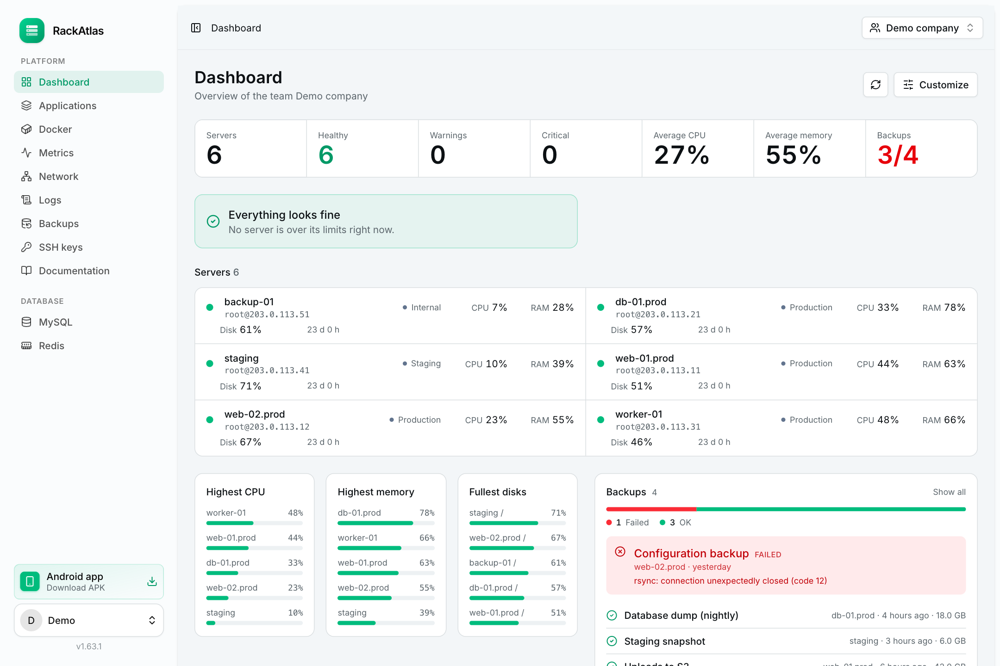
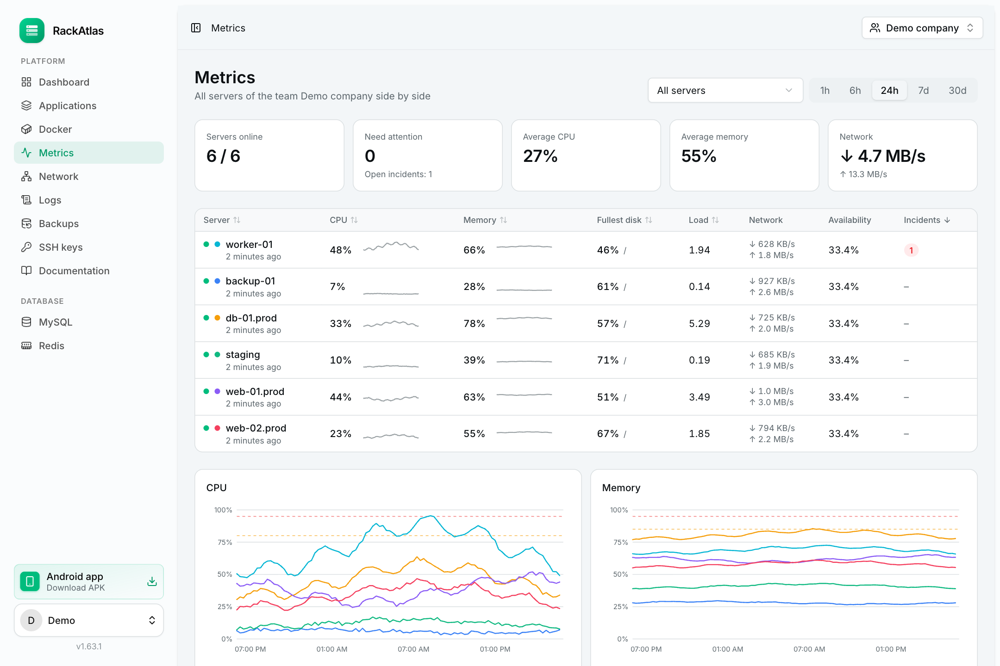
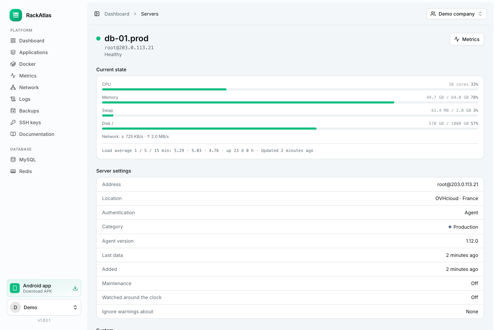

# RackAtlas

[](LICENSE)
[](https://www.php.net/)
[](https://laravel.com/)
[](https://inertiajs.com/)

**Self-hosted server monitoring and operations for small teams.** Keep an inventory of your servers, watch their health
in near real time, get alerted when something breaks, and fix it from the same place: restart a service, manage Docker
containers or open a shell in the browser.

RackAtlas collects data in two ways, so it fits almost any machine:

- **Agent (push).** A tiny POSIX shell agent (Debian/Ubuntu) or a Go service (Windows) reports metrics and serious log
  entries over HTTPS. Nothing connects into the server.
- **SSH (pull).** For machines where you cannot or do not want to install anything, RackAtlas logs in over SSH and
  collects the same data.

## Screenshots



| Metrics | Server detail |
| --- | --- |
|  |  |

The screenshots show the built-in demo workspace with made-up servers.

## Features

- **Server inventory.** Servers, categories, providers, countries, notes and per-server documentation.
- **Metrics.** CPU, load, memory, disks, uptime and network traffic with history and per-server report intervals
  (10 seconds to 12 hours, default 1 minute).
- **Logs.** Critical and error entries from the systemd journal, grouped and searchable, plus failed units.
- **Alerts.** Thresholds for CPU, memory and disk, failed services, offline servers, databases and Redis. Per-server
  mute rules and maintenance mode.
- **Anomaly detection.** Compares a server with its own last day (median + MAD) and forecasts disks that are about to fill.
  Optionally explains incidents with a local LLM through [Ollama](https://ollama.com); nothing leaves your network.
- **Applications.** List systemd services, start, stop, restart, read the status and the journal. All over SSH, instantly.
- **Docker.** Containers, state, restart and logs over SSH.
- **MySQL and Redis.** Connections, throughput, replication topology, slow query insight and memory metrics.
- **Network.** Interfaces, throughput and findings per server and across the fleet.
- **Backups.** Expect a backup on a schedule and get notified when it is missing.
- **Web terminal.** An SSH shell in the browser through a small WebSocket bridge, with persistent tmux sessions and
  saved snippets. Credentials never reach the browser.
- **SSH key management.** Store keys, copy a ready `authorized_keys` command, verify host key fingerprints.
- **Teams.** Multiple teams, invitations, roles, two-factor authentication and device tracking.
- **Notifications.** E-mail, Web Push and mobile push (Firebase) with per-event preferences.
- **REST API.** Token-authenticated, versioned API (`/api/v1`) with an API log.
- **Administration.** User management, sign in as a user to help them set things up, activity log and API log.
- **Mobile apps.** A Capacitor shell for Android in `../mobile`.
- **Languages.** English, Slovak and Czech.

## Stack

| Layer     | Technology                                                                     |
| --------- | ------------------------------------------------------------------------------ |
| Backend   | PHP 8.3+, Laravel 13, Laravel Fortify, Spatie Activitylog, phpseclib (SSH)     |
| Frontend  | React, Inertia v3, TypeScript, Tailwind CSS, Vite, Laravel Wayfinder           |
| Data      | MySQL (or any database Laravel supports), Redis for cache, sessions and queues |
| Agents    | POSIX `sh` + systemd timer (`.deb`), Go (Windows service)                      |
| Terminal  | Node.js WebSocket bridge in `resources/terminal`                               |
| Quality   | PHPUnit, Larastan (PHPStan), Laravel Pint                                      |

## Requirements

- PHP 8.3 or newer with the usual Laravel extensions
- Composer 2
- Node.js 20 or newer and npm
- MySQL 8 / MariaDB (SQLite works for local development)
- Redis (recommended; required for queues in production)
- A web server (nginx or Apache) with HTTPS. Agents refuse plain HTTP.

## Quick start

```bash
git clone https://github.com/miominarik/rackatlas.git
cd rackatlas

composer setup          # install, .env, key, migrate, npm install, build
composer dev            # server, queue worker, scheduler and Vite
```

Open the URL printed by `composer dev`, set `ENABLE_REGISTER=true` in `.env` and sign up. Then make yourself an admin:

```bash
php artisan user:admin you@example.com
```

Registration is closed by default. While `ENABLE_REGISTER` is on, anyone can sign up; set it back to `false` afterwards
to close the instance. The sign-up page and the link on the login screen only exist while it is on.

## Configuration

Copy `.env.example` to `.env`. The most important settings:

| Variable                                   | Purpose                                                                      |
| ------------------------------------------ | ---------------------------------------------------------------------------- |
| `APP_URL`                                  | Public HTTPS address. Agents and the installer use it.                       |
| `DB_*`, `REDIS_*`                          | Database and Redis connections.                                              |
| `MAIL_*`                                   | Outgoing mail for invitations and alerts.                                    |
| `ENABLE_REGISTER`                          | `true` allows public sign-up, anything else closes it.                       |
| `TURNSTILE_SITE_KEY`, `TURNSTILE_SECRET_KEY` | Optional Cloudflare Turnstile on public forms. Empty turns it off.         |
| `VAPID_*`                                  | Web Push keys. Generate with `php artisan webpush:keys`. |
| `FIREBASE_CREDENTIALS`                     | Optional, for mobile push.                                                   |
| `TERMINAL_*`                               | Address, port and shared secret of the terminal bridge.                      |
| `WATCH_*`                                  | Continuous watching and the optional local LLM. See `resources/watch/README.md`. |

### Long-running processes

Besides PHP-FPM (or any web server running the app), RackAtlas needs a few background processes. In development
`composer dev` starts the scheduler, the queue worker and Vite for you. In production run each one as a service.

| Process          | Command                                  | Needed for                                              |
| ---------------- | ---------------------------------------- | ------------------------------------------------------- |
| Scheduler        | `php artisan schedule:work`              | Collecting metrics, evaluating alerts, backups, cleanup |
| Queue worker     | `php artisan queue:work`                 | Notifications and other background jobs                 |
| SSR (optional)   | `php artisan inertia:start-ssr`          | Server-side rendering of the public pages               |
| Terminal bridge  | `npm run terminal`                       | The web terminal                                        |
| Watcher (opt.)   | `php artisan watch:run`                  | Continuous anomaly watching (see `resources/watch/README.md`) |
| LLM queue (opt.) | `php artisan queue:work --queue=llm`     | Incident explanations from a local model                |

Instead of `schedule:work` you can use cron: `* * * * * cd /path/to/app && php artisan schedule:run >> /dev/null 2>&1`.

Example systemd units (adjust the user and paths; `php` must be the PHP that has the same extensions as the web server):

```ini
# /etc/systemd/system/rackatlas-scheduler.service
[Unit]
Description=RackAtlas scheduler
After=network.target

[Service]
User=www-data
WorkingDirectory=/var/www/rackatlas
ExecStart=/usr/bin/php artisan schedule:work
Restart=always
RestartSec=3

[Install]
WantedBy=multi-user.target
```

```ini
# /etc/systemd/system/rackatlas-queue.service
[Unit]
Description=RackAtlas queue worker
After=network.target

[Service]
User=www-data
WorkingDirectory=/var/www/rackatlas
ExecStart=/usr/bin/php artisan queue:work --sleep=3 --tries=3 --max-time=3600
Restart=always
RestartSec=3

[Install]
WantedBy=multi-user.target
```

```ini
# /etc/systemd/system/rackatlas-ssr.service
[Unit]
Description=RackAtlas SSR
After=network.target

[Service]
User=www-data
WorkingDirectory=/var/www/rackatlas
ExecStart=/usr/bin/php artisan inertia:start-ssr
Restart=always
RestartSec=3

[Install]
WantedBy=multi-user.target
```

```ini
# /etc/systemd/system/rackatlas-terminal.service
[Unit]
Description=RackAtlas web terminal bridge
After=network.target

[Service]
User=www-data
WorkingDirectory=/var/www/rackatlas
ExecStart=/usr/bin/npm run terminal
Restart=always
RestartSec=3

[Install]
WantedBy=multi-user.target
```

```bash
sudo systemctl daemon-reload
sudo systemctl enable --now rackatlas-scheduler rackatlas-queue rackatlas-ssr rackatlas-terminal
```

After every deploy run `php artisan queue:restart` and restart the services, because they keep the old code in memory.

### Web terminal

The terminal is a small Node.js bridge (`resources/terminal/server.mjs`, Node 20.6+) between the browser (WebSocket) and
the server (SSH). It reads `.env`, so set:

```dotenv
TERMINAL_SECRET=<long random string>   # shared with the app
TERMINAL_HOST=127.0.0.1
TERMINAL_PORT=8787
TERMINAL_URL=wss://your-rackatlas/terminal-ws   # what the browser connects to
```

Start it with `npm run terminal` (the systemd unit above) and proxy a WebSocket path to it, for example in nginx:

```nginx
location /terminal-ws {
    proxy_pass http://127.0.0.1:8787;
    proxy_http_version 1.1;
    proxy_set_header Upgrade $http_upgrade;
    proxy_set_header Connection "upgrade";
    proxy_set_header X-Forwarded-For $remote_addr;
    proxy_read_timeout 3600s;
}
```

The bridge exchanges a one-time ticket from the app for SSH login details over a private
API, so passwords and keys never reach the browser. It keeps sessions in `tmux` when the server has it.

## Adding servers

**With the agent (recommended).** Create a server in the UI, open its *Agent* page and run the shown command on the
machine:

```bash
curl -fsSL https://your-rackatlas/agent/install.sh | sudo bash -s -- --url https://your-rackatlas --token ra_...
```

It adds a signed apt repository, installs `rackatlas-agent`, writes the token and starts a systemd timer. Updates arrive
with `apt upgrade`. The agent runs unprivileged and sandboxed, sends the token only as a bearer header and caps the size
of every report. A Windows service is available as well.

**With SSH.** Add an SSH key or password to the server. RackAtlas verifies and pins the host key fingerprint and collects
data on its own schedule. Actions such as service restarts and Docker commands always use SSH.

## Development

```bash
composer dev                     # everything at once
php artisan test --compact       # run the test suite
vendor/bin/pint --dirty          # format PHP
vendor/bin/phpstan analyse       # static analysis
npm run types:check              # frontend type check
npm run build                    # production assets
php artisan wayfinder:generate --with-form   # regenerate typed route helpers
```

Project layout:

```
app/            Controllers, models, services (Ssh, Alerts, Docker, Database, Redis, Network, Watch, ...)
agent/          Debian and Windows agents, apt repository tooling (see agent/AGENTS.md)
resources/js/   Inertia pages and React components
resources/terminal/  Web terminal bridge
routes/         web, api, settings and console schedule
tests/          Feature and unit tests
lang/           Translations (sk, cs)
```

Contributors working on the agent should read [`agent/AGENTS.md`](agent/AGENTS.md) first: the report format is a
contract with servers that may stay on an old agent version for years.

## Deployment

Build assets on the target (`public/build` and `bootstrap/ssr` are not committed), then:

```bash
composer install --no-dev --optimize-autoloader
php artisan migrate --force
npm ci && npm run build
php artisan config:cache route:cache view:cache
```

Restart the long-running processes after every deploy (see above).

## Security

- Passwords and SSH secrets are stored encrypted. Agent tokens are secrets and are never logged.
- SSH host keys are pinned per server.
- Admin impersonation is audited and cannot be used on other admins or to change passwords.
- Report vulnerabilities privately (see [Contributing](#contributing)), not in a public issue.

## License

RackAtlas is free software under the [GNU Affero General Public License v3.0](LICENSE) (AGPL-3.0-only). You may use,
modify and self-host it. If you offer a modified version to others over a network, you must make your source code
available under the same license.

## Contributing

Bug reports and feature requests are welcome as [issues](../../issues). The project does not accept pull requests,
so please do not open one; describe the problem or idea in an issue instead.

For security problems do not open a public issue. Contact the maintainer privately.
